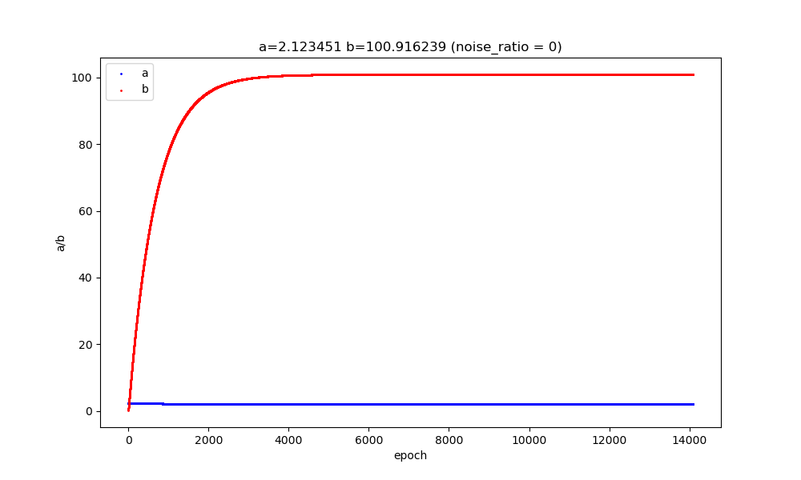
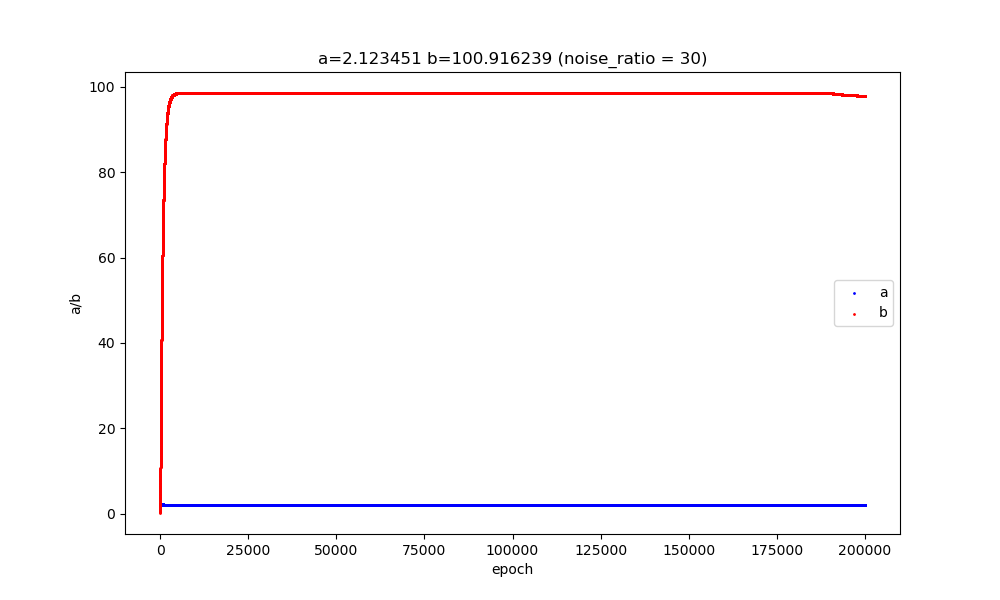
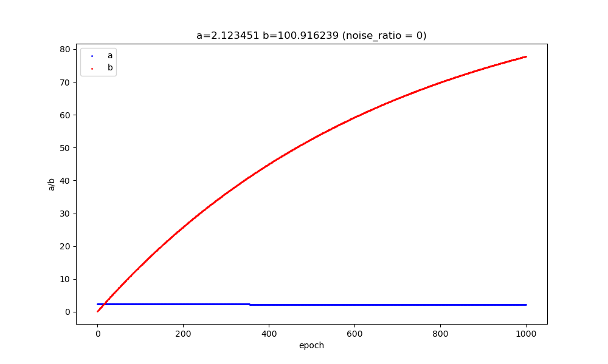
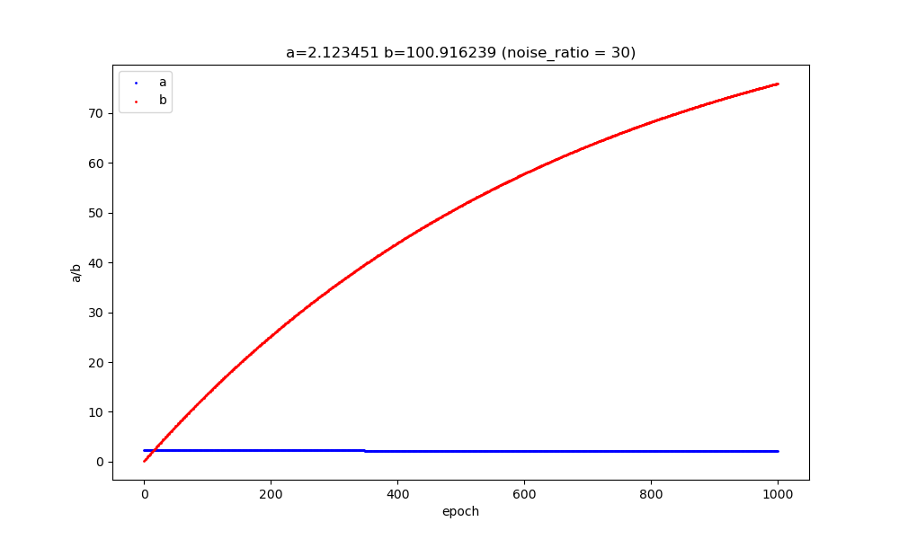

[中文版本 README_CN.md](README_CN.md)

Given a series of 2D coordinate points that lie near a straight line — some on the line, some beside it, and some as outliers.

Let the line equation be: $y = ax +b$

The goal is to find a line equation that minimizes the sum of squared *vertical* distances from all points to the line: $\text{z}$ = $\sum_{i=1}^{n}{(y_i - y'_i)^2}$

We use vertical distance rather than the shortest distance to the line because the shortest distance formula $d=\frac{|ax_0+b-y_0|}{\sqrt{a^2+b^2}}$ contains an absolute value, whose derivative is discontinuous — making differentiation and computation inconvenient.

Loss function definition: $\text{z}$ = $\sum_{i=1}^{n}{(y_i - y'_i)^2}$

This is equivalent to finding the minimum of a function `sum`, where the corresponding $a$ and $b$ are obtained when `sum` reaches its minimum.

Substituting the line equation: $\text{z}$ = $\sum_{i=1}^{n}{[y_i - (a\cdot x_i+b)]^2}$

This function has two independent variables $y_i$ and $x_i$, one dependent variable $\text{z}$, with $a$ and $b$ as unknowns. We need to solve for $a$ and $b$ using the coordinate points $(x_i,y_i)$.

Taking partial derivatives: $\frac{\delta\text{z}}{\delta a}=-2\sum_{i=1}^{n}x_i{[y_i - (a\cdot x_i+b)]}$

$\frac{\delta\text{z}}{\delta b}=-2\sum_{i=1}^{n}{[y_i - (a\cdot x_i+b)]}$

## Setting Partial Derivatives to Zero

The standard approach in calculus is to set the partial derivatives to zero: $\frac{\delta\text{z}}{\delta a}=0$ and $\frac{\delta\text{z}}{\delta b}=0$, then solve the resulting system of two equations.

That is: $\sum_{i=1}^{n}{x_iy_i}-a\sum_{i=1}^{n}{x^2_i}=b\sum_{i=1}^{n}{x_i}$, and $\sum_{i=1}^{n}y_i-a\sum_{i=1}^{n}x_i = bn$

Let $S_{xy} = \sum_{i=1}^{n}{x_iy_i}$, $S_{xx} = \sum_{i=1}^{n}{x^2_i}$, $S_x=\sum_{i=1}^{n}x_i$, $S_y=\sum_{i=1}^{n}y_i$

We get $a\cdot S_{xx}+b\cdot S_x=S_{xy}$ and $a\cdot S_x + bn=S_y$

The coefficient determinant $\Delta$: $`\Delta=\begin{vmatrix}S_{xx}&S_x\\S_x& n\end{vmatrix}=n\cdot S_{xx}-S^2_x`$

By Cramer's rule: $a=\frac{nS_{xy}-S_xS_y}{n\cdot S_{xx}-S^2_x}$, $b=\frac{S_yS_{xx}-S_xS_{xy}}{n\cdot S_{xx}-S^2_x}$

For simple functions, setting partial derivatives to zero yields an analytical solution. For more complex functions, no analytical solution exists — we must use alternative methods to find $a$ and $b$. Gradient descent is one such method.

## Gradient Descent

[https://zoujiu.blog.csdn.net/article/details/159514721?spm=1011.2415.3001.5331](https://zoujiu.blog.csdn.net/article/details/159514721?spm=1011.2415.3001.5331)

Treat $a$ and $b$ as parameters.

Full loss function: $\text{z}$ = $\sum_{i=1}^{n}{[y_i - (a\cdot x_i+b)]^2}$. Since the full dataset may not fit in memory, we typically use the per-sample loss instead — this leads to the Stochastic Gradient Descent (SGD) algorithm.

Per-sample loss: $z=loss={[y_i - (a\cdot x_i+b)]^2}$. The loss should be as small as possible.

We know $\frac{\delta\text{z}}{\delta a}=-2x_i{[y_i - (a\cdot x_i+b)]}$

$\frac{\delta\text{z}}{\delta b}=-2{[y_i - (a\cdot x_i+b)]}$

From calculus, the gradient is a vector: $\frac{\delta\text{z}}{\delta a}i$ + $\frac{\delta\text{z}}{\delta b}j$. A function decreases most rapidly along the direction of the negative gradient.

At each data point, the update for $a$ is $\frac{\delta\text{z}}{\delta a}$, and for $b$ is $\frac{\delta\text{z}}{\delta b}$.

First, randomly initialize $a$ and $b$.

Then update the parameters: $a'=a-lr\cdot \frac{\delta\text{z}}{\delta a}$, $b'=b - lr\cdot \frac{\delta\text{z}}{\delta b}$, where $lr$ is the learning rate — typically a small value like 0.0001 or 0.001.

Move to the next data point, compute the gradients again: $\frac{\delta\text{z}}{\delta a}=-2x_j{[y_j - (a\cdot x_j+b)]}$, $\frac{\delta\text{z}}{\delta b}=-2{[y_j - (a\cdot x_j+b)]}$

Update again: $a''=a'-lr\cdot \frac{\delta\text{z}}{\delta a}$, $b''=b' - lr\cdot \frac{\delta\text{z}}{\delta b}$

Repeat over all data points.

This approach does not require an analytical solution — only the data itself. We can also accumulate gradients over multiple samples before updating:

$\sum_{i=1}^{k}\frac{\delta z}{\delta a_i}$, $\sum_{i=1}^{k}\frac{\delta z}{\delta b_i}$

$a'=a-lr\cdot \sum_{i=1}^{k}\frac{\delta z}{\delta a_i}$, $b'=b - lr\cdot \sum_{i=1}^{k}\frac{\delta z}{\delta b_i}$

### Principle of the Gradient Descent Update Formula

Why is the update formula: `new_value = current_value - learning_rate × partial derivative`, i.e. $a'= a - lr\cdot \frac{\delta z}{\delta a}$, $b'= b - lr\cdot \frac{\delta z}{\delta b}$, rather than some other form?

The ultimate goal of updating parameters $a$ and $b$ is to minimize the loss function — the per-sample loss $z=loss={[y_i - (a\cdot x_i+b)]^2}$ should be as small as possible, and the overall loss should also decrease: $Z_{all}$ = $\sum_{i=1}^{n}{[y_i - (a\cdot x_i+b)]^2}$

The ideal situation is that **`each time we update parameters a and b, the overall loss $Z_{all}$ decreases by a little bit`**. According to calculus, the direction of fastest decrease of a function is the negative gradient direction. The gradient is a vector: $\Delta=(\frac{\delta z}{\delta a}, \frac{\delta z}{\delta b})$

**`Each time we update parameters a and b, the overall loss $Z_{all}$ decreases by a little bit`**. Let the changes in $a$ and $b$ be $\Delta a$ and $\Delta b$, and let $f(a, b) = Z_{all} =\sum_{i=1}^{n}{[y_i - (a\cdot x_i+b)]^2} $

After updating only parameter $a$, we want: $f(a + \Delta a, b) < f(a, b)$, i.e. $f(a + \Delta a) < f(a)$

The Taylor expansion of a function is:

$f(x)=f(x_0)+f'(x_0)(x-x_0)+\frac{f^{(2)}(x_0)}{2!}(x-x_0)^2+...+\frac{f^{(n)}(x_0)}{n!}(x-x_0)^n+o(x-x_0)^n$

Assume $f$ is differentiable near $a$ and has derivatives up to order $n$, then:

$f(a + \Delta a)=f(a)+f'(a)\Delta a+\frac{f^{(2)}(a)}{2!}(\Delta a)^2+...+\frac{f^{(n)}(a)}{n!}(\Delta a)^n+o(\Delta a)^n$

We know $f(a, b)>0$, and after updating $a$, the total loss $Z_{all}$ must decrease, i.e. $f(a + \Delta a) < f(a)$.

Therefore: $f'(a)\Delta a+\frac{f^{(2)}(a)}{2!}(\Delta a)^2+...+\frac{f^{(n)}(a)}{n!}(\Delta a)^n+o(\Delta a)^n < 0$

Since $\frac{f^{(2)}(a)}{2!}(\Delta a)^2+...+\frac{f^{(n)}(a)}{n!}(\Delta a)^n+o(\Delta a)^n = o(\Delta a)$ (a higher-order infinitesimal), this simplifies to: $f'(a)\Delta a+o(\Delta a) < 0$

When $\Delta a$ is small, $o(\Delta a)$ is also very close to zero, so the leading term $f'(a)\Delta a < 0$ must hold. This means $f'(a)$ and $\Delta a$ must have **opposite signs**: if $f'(a) < 0$ then $\Delta a > 0$, and if $f'(a) > 0$ then $\Delta a < 0$.

Only when $f'(a)$ and $\Delta a$ have opposite signs can we achieve: **`each time we update parameters a and b, the overall loss $Z_{all}$ decreases by a little bit`**

Now, how exactly should we update $a$ and $b$, and by how much? Let the updated parameters be $a'$ and $b'$, so $a'= a + \Delta a$ and $b'= b + \Delta b$. We don't directly know the values of $\Delta a$ and $\Delta b$, but we do know $f'(a)$ and $f'(b)$.

We know that $f'(a)$ and $\Delta a$ have opposite signs, and $f'(b)$ and $\Delta b$ have opposite signs. A simple way to satisfy this is to set $\Delta a = -lr\cdot f'(a)$ and $\Delta b = -lr\cdot f'(b)$, where $lr > 0$.

Therefore $a'= a - lr\cdot f'(a)$, $b'= b - lr\cdot f'(b)$, which is $a'= a - lr\cdot \frac{\delta z}{\delta a}$, $b'= b - lr\cdot \frac{\delta z}{\delta b}$

This is where the minus sign and the partial derivative in the update formula come from. The prerequisite is that the step size $\Delta a$ must be small enough that the first-order term in the Taylor expansion dominates — which is where the learning rate comes in to control the step size.

How is the learning rate determined? We had $f'(a)\Delta a+o(\Delta a) < 0$. Substituting $\Delta a = -lr\cdot f'(a)$:

$-f'(a)\cdot lr\cdot f'(a)+o(-lr\cdot f'(a)) < 0$, which simplifies to: $-({f'}(a))^2\cdot lr+o(-lr\cdot f'(a)) < 0$

Or equivalently: $o(-lr\cdot f'(a)) < ({f'}(a))^2\cdot lr$, where $({f'}(a))^2\cdot lr>0$. This inequality only holds when $lr$ is sufficiently small — so that the infinitesimal term on the left is small enough, specifically smaller than the right-hand side.

Therefore the learning rate $lr$ is a necessary parameter. At this point we have answered why the update formula is: `new_value = current_value - learning_rate × partial derivative`, i.e. $a'= a - lr\cdot \frac{\delta z}{\delta a}$, $b'= b - lr\cdot \frac{\delta z}{\delta b}$. The ultimate goal is always: **`each time we update parameters a and b, the overall loss $Z_{all}$ decreases by a little bit`**

The learning rate $lr$ serves as a step-size scaling factor. The first-order term $({f'}(a))^2\cdot lr$ grows as $lr$ increases, but the remainder term $o(-lr\cdot f'(a))$ also grows. If the remainder term becomes greater than or equal to the first-order term, the inequality $o(-lr\cdot f'(a)) < ({f'}(a))^2\cdot lr$ breaks down. Setting $lr$ small leaves enough room for the remainder term.

If $lr$ is too large, the loss may not decrease — it may even increase, or the optimization may oscillate.

**Corollary:** If $f'(a) > 0$, then $a'= a - lr\cdot \frac{\delta z}{\delta a}$ gives $a' < a$. If $f'(a) < 0$, then $a'= a - lr\cdot \frac{\delta z}{\delta a}$ gives $a' > a$. In both cases, the parameter moves in the direction that decreases $f(a)$.

## Examples

First, noise-free data was generated. The results from the partial-derivative approach and gradient descent are nearly identical.

Then a noisy dataset was generated. The partial-derivative fit is reasonable, and gradient descent produces similar results.

Due to the large difference in scale between $a$ and $b$, their learning speeds differ significantly. $a$ converges very early (epoch < 1000), while $b$ does not converge until epoch > 30000.

This is why techniques like BatchNorm (which normalizes layer outputs) and L2 regularization / weight decay (which constrains parameter magnitudes) are needed — to prevent mismatched learning speeds between parameters and slow convergence.

## 3D Coordinate Points

The 3D case is analogous. Either set partial derivatives to zero to obtain a system of three equations and solve for coefficients $a, b, c$; or use gradient descent with a small neural network to iteratively find $a, b, c$.
