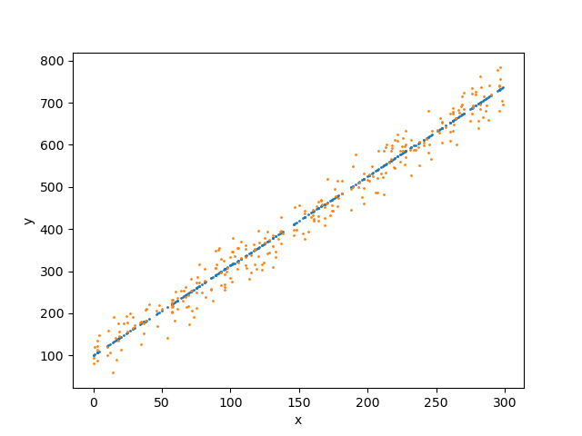

[中文版本 README_CN.md](README_CN.md)

Given a series of 2D coordinate points that lie near a straight line — some on the line, some beside it, and some as outliers.

Let the line equation be: $y = ax +b$

The goal is to find a line equation that minimizes the sum of squared distances from all points to the line, $\text{z}$ = $\sum_{i=1}^{n}{(y_i - y'_i)^2}$

Loss function: $\text{z}$ = $\sum_{i=1}^{n}{(y_i - y'_i)^2}$

This is equivalent to finding the minimum of a function `sum`, where the corresponding $a$ and $b$ are obtained when `sum` reaches its minimum.

Substituting: $\text{z}$ = $\sum_{i=1}^{n}{[y_i - (a\cdot x_i+b)]^2}$

This function has two independent variables $y_i$ and $x_i$, one dependent variable $\text{z}$, with $a$ and $b$ as unknowns. We need to solve for $a$ and $b$ using the coordinate points $(x_i,y_i)$.

Taking partial derivatives: $\frac{\delta\text{z}}{\delta a}=-2\sum_{i=1}^{n}x_i{[y_i - (a\cdot x_i+b)]}$

$\frac{\delta\text{z}}{\delta b}=-2\sum_{i=1}^{n}{[y_i - (a\cdot x_i+b)]}$

## Setting Partial Derivatives to Zero

The standard approach in calculus is to set the partial derivatives to zero: $\frac{\delta\text{z}}{\delta a}=0$ and $\frac{\delta\text{z}}{\delta b}=0$, then solve the resulting system of two equations.

That is: $\sum_{i=1}^{n}{x_iy_i}-a\sum_{i=1}^{n}{x^2_i}=b\sum_{i=1}^{n}{x_i}$, and $\sum_{i=1}^{n}y_i-a\sum_{i=1}^{n}x_i = bn$

Let $S_{xy} = \sum_{i=1}^{n}{x_iy_i}$, $S_{xx} = \sum_{i=1}^{n}{x^2_i}$, $S_x=\sum_{i=1}^{n}x_i$, $S_y=\sum_{i=1}^{n}y_i$

We get $a\cdot S_{xx}+b\cdot S_x=S_{xy}$ and $a\cdot S_x + bn=S_y$

The coefficient determinant $\Delta$: $`\Delta=\begin{vmatrix}S_{xx}&S_x\\S_x& n\end{vmatrix}=n\cdot S_{xx}-S^2_x`$

By Cramer's rule: $a=\frac{nS_{xy}-S_xS_y}{n\cdot S_{xx}-S^2_x}$, $b=\frac{S_yS_{xx}-S_xS_{xy}}{n\cdot S_{xx}-S^2_x}$

For simple functions, setting partial derivatives to zero yields an analytical solution. For more complex functions, no analytical solution exists — we must use alternative methods to find $a$ and $b$. Gradient descent is one such method.

## Gradient Descent

[https://zoujiu.blog.csdn.net/article/details/159514721?spm=1011.2415.3001.5331](https://zoujiu.blog.csdn.net/article/details/159514721?spm=1011.2415.3001.5331)

Treat $a$ and $b$ as parameters.

Full loss function: $\text{z}$ = $\sum_{i=1}^{n}{[y_i - (a\cdot x_i+b)]^2}$. Since the full dataset may not fit in memory, we typically use the per-sample loss instead.

Per-sample loss: $z=loss={[y_i - (a\cdot x_i+b)]^2}$. The loss should be as small as possible.

We know $\frac{\delta\text{z}}{\delta a}=-2x_i{[y_i - (a\cdot x_i+b)]}$

$\frac{\delta\text{z}}{\delta b}=-2{[y_i - (a\cdot x_i+b)]}$

From calculus, the gradient is a vector, $\frac{\delta\text{z}}{\delta a}i$+$\frac{\delta\text{z}}{\delta b}j$. A function decreases most rapidly along the direction of the negative gradient.

At each data point, the update for $a$ is $\frac{\delta\text{z}}{\delta a}$, and for $b$ is $\frac{\delta\text{z}}{\delta b}$.

First, randomly initialize $a$ and $b$.

Then update the parameters: $a'=a-lr\cdot \frac{\delta\text{z}}{\delta a}$, $b'=b - lr\cdot \frac{\delta\text{z}}{\delta b}$, where $lr$ is the learning rate — typically a small value like 0.0001 or 0.001.

Move to the next data point, compute the gradients again: $\frac{\delta\text{z}}{\delta a}=-2x_j{[y_j - (a\cdot x_j+b)]}$, $\frac{\delta\text{z}}{\delta b}=-2{[y_j - (a\cdot x_j+b)]}$

Update again: $a''=a'-lr\cdot \frac{\delta\text{z}}{\delta a}$, $b''=b' - lr\cdot \frac{\delta\text{z}}{\delta b}$

Repeat over all data points.

This approach does not require an analytical solution — only the data itself. We can also accumulate gradients over multiple samples before updating:

$\sum_{i=1}^{k}\frac{\delta z}{\delta a_i}$, $\sum_{i=1}^{k}\frac{\delta z}{\delta b_i}$

$a'=a-lr\cdot \sum_{i=1}^{k}\frac{\delta z}{\delta a_i}$, $b'=b - lr\cdot \sum_{i=1}^{k}\frac{\delta z}{\delta b_i}$

## Examples

First, noise-free data was generated. The results from the partial-derivative approach and gradient descent are nearly identical.

Then a noisy dataset was generated. The partial-derivative fit is reasonable, and gradient descent produces similar results.

Due to the large difference in scale between $a$ and $b$, their learning speeds differ significantly. $a$ converges very early (epoch < 1000), while $b$ does not converge until epoch > 30000.

This is why techniques like BatchNorm (which normalizes layer outputs) and L2 regularization / weight decay (which constrains parameter magnitudes) are needed — to prevent mismatched learning speeds between parameters and slow convergence.

## 3D Coordinate Points

The 3D case is analogous. Either set partial derivatives to zero to obtain a system of three equations and solve for coefficients $a, b, c$; or use gradient descent with a small neural network to iteratively find $a, b, c$.
