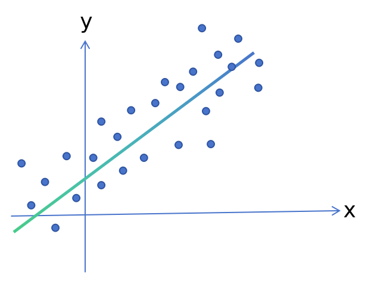

[English version README.md](README.md)

给定一系列的二维坐标点，这些点在一条直线的旁边，某些落在直线上，某些在直线旁边，某些是离群点

不妨令直线方程是：$y = ax +b$

现在需要求出一条直线方程，让所有坐标点到该直线的竖直距离累加和最小，$\text{z}$ = $\sum_{i=1}^{n}{(y_i - y'_i)^2}$  

至于为什么不使用到直线的最短距离，是因为到直线的最短距离$d=\frac{|ax_0+b-y_0|}{\sqrt{a^2+b^2}}$包含绝对值，导数不连续，求导数不方便，计算不方便

损失函数定义：$\text{z}$ = $\sum_{i=1}^{n}{(y_i - y'_i)^2}$

也就相当是求一个函数sum的极小值，当函数sum取得极小值时，对应的a和b

代入得：$\text{z}$ = $\sum_{i=1}^{n}{[y_i - (a\cdot x_i+b)]^2}$

该函数两个自变量$y_i$和$x_i$，一个因变量$\text{z}$，a和b是未知数，需要使用坐标点$(x_i,y_i)$求出a和b

对函数求偏导数：$\frac{\delta\text{z}}{\delta a}=-2\sum_{i=1}^{n}x_i{[y_i - (a\cdot x_i+b)]}$

$\frac{\delta\text{z}}{\delta b}=-2\sum_{i=1}^{n}{[y_i - (a\cdot x_i+b)]}$

## 偏导数=0

按照高等数学里面通常的方案，一般是令偏导数等于0，$\frac{\delta\text{z}}{\delta a}=0$， $\frac{\delta\text{z}}{\delta b}=0$，然后得到两个方程，求出方程的解就可以了

即：$\sum_{i=1}^{n}{x_iy_i}-a\sum_{i=1}^{n}{x^2_i}=b\sum_{i=1}^{n}{x_i}$，和 $\sum_{i=1}^{n}y_i-a\sum_{i=1}^{n}x_i = bn$

令$S_{xy} = \sum_{i=1}^{n}{x_iy_i}$，$S_{xx} = \sum_{i=1}^{n}{x^2_i}$,$\qquad$ $S_x=\sum_{i=1}^{n}x_i$, $S_y=\sum_{i=1}^{n}y_i$

得$a\cdot S_{xx}+b\cdot S_x=S_{xy}$ 和 $a\cdot S_x + bn=S_y$

系数行列式$\Delta$：$`\Delta=\begin{vmatrix}S_{xx}&S_x\\S_x& n\end{vmatrix}=n\cdot S_{xx}-S^2_x`$

根据克拉默法则，求出 $a=\frac{nS_{xy}-S_xS_y}{n\cdot S_{xx}-S^2_x}$, $b=\frac{S_yS_{xx}-S_xS_{xy}}{n\cdot S_{xx}-S^2_x}$

对于比较简单的函数，用偏导数=0是可以求出结果的，对于相当复杂的函数，是求不出解析解的，只能采用其他的方式求出未知数a和b，梯度下降就是其中的一种方式。

## 梯度下降

[https://zoujiu.blog.csdn.net/article/details/159514721?spm=1011.2415.3001.5331](https://zoujiu.blog.csdn.net/article/details/159514721?spm=1011.2415.3001.5331)

此时将a和b看作参数

真实的损失函数：$\text{z}$ = $\sum_{i=1}^{n}{[y_i - (a\cdot x_i+b)]^2}$，考虑到数据太多，内存可能不够，所以一般只用单个数据项的损失函数，也就是随机梯度下降算法。

单个数据项的损失函数：$z=loss={[y_i - (a\cdot x_i+b)]^2}$，损失函数越小越好

已知，$\frac{\delta\text{z}}{\delta a}=-2x_i{[y_i - (a\cdot x_i+b)]}$

$\frac{\delta\text{z}}{\delta b}=-2{[y_i - (a\cdot x_i+b)]}$

根据高等数学的内容，梯度是一个向量，$\frac{\delta\text{z}}{\delta a}i$+$\frac{\delta\text{z}}{\delta b}j$，函数沿着梯度方向下降速度最快

此时可以遍历一个数据项，a的变化量是$\frac{\delta\text{z}}{\delta a}$，b的变化量是这个$\frac{\delta\text{z}}{\delta b}$

首先随机给a和b一个初始数值

然后就可以更新参数a和b，$a'=a-lr\cdot \frac{\delta\text{z}}{\delta a}$, $b'=b - lr\cdot \frac{\delta\text{z}}{\delta b}$，lr是learning_rate学习率，一般是比较小的数字像0.0001, 0.001等

再遍历一个数据项，得到a和b的变化量$\frac{\delta\text{z}}{\delta a}=-2x_j{[y_j - (a\cdot x_j+b)]}$，$\frac{\delta\text{z}}{\delta b}=-2{[y_j - (a\cdot x_j+b)]}$

再次更新一点的：$a''=a'-lr\cdot \frac{\delta\text{z}}{\delta a}$, $b''=b' - lr\cdot \frac{\delta\text{z}}{\delta b}$

然后不断遍历其他数据

这样就不需要求出解析解，只需要用数据就可以求出a和b，还可以求出多个数据项的a和b的变化量，然后再更新a和b，变化量只需要累加就可以了

也就是 $\sum_{i=1}^{k}\frac{\delta z}{\delta a_i}$, $\sum_{i=1}^{k}\frac{\delta z}{\delta b_i}$

$a'=a-lr\cdot \sum_{i=1}^{k}\frac{\delta z}{\delta a_i}$, $b'=b - lr\cdot \sum_{i=1}^{k}\frac{\delta z}{\delta b_i}$

### 梯度下降的更新公式的原理
也就是为什么更新的公式是：【当前值减去学习率乘以偏导数, $a'= a - lr\cdot \frac{\delta z}{\delta a}$，$b'= b - lr\cdot \frac{\delta z}{\delta b}$】，而不是别的其他形式的公式

首先需要明确，不管怎么更新参数a和b，最终的目的都是让损失函数的数值最小，也就是单项损失：$z=loss={[y_i - (a\cdot x_i+b)]^2}$越小越好，总体损失LOSS越小越好，$Z_{all}$ = $\sum_{i=1}^{n}{[y_i - (a\cdot x_i+b)]^2}$

最理想的情况是，**`每次更新参数a和b，总体损失函数的数值$Z_{all}$都变小一点`**，每次更新以后，$Z_{all}$的数值一直在减少，根据高等数学的知识，函数下降最快的方向是梯度方向，梯度是一个向量：$\Delta=(\frac{\delta z}{\delta a}, \frac{\delta z}{\delta b})$

**`每次更新参数a和b，总体损失函数的数值$Z_{all}$都变小一点`**，不妨假设参数a和b的变化量是$\Delta a$和$\Delta b$，令$f(a, b) = Z_{all} =\sum_{i=1}^{n}{[y_i - (a\cdot x_i+b)]^2} $

单独更新参数a以后，应该满足$f(a + \Delta a, b) < f(a, b)$，即$f(a + \Delta a) < f(a)$

函数的泰勒展开式是：$f(x)=f(x_0)+f'(x_0)(x-x_0)+\frac{f^{(2)}(x_0)}{2!}(x-x_0)^2+...+\frac{f^{(n)}(x_0)}{n!}(x-x_0)^n+o(x-x_0)^n$

不妨设函数f在a附近可微，存在n阶导数，所以：$f(a + \Delta a)=f(a)+f'(a)\Delta a+\frac{f^{(2)}(a)}{2!}(\Delta a)^2+...+\frac{f^{(n)}(a)}{n!}(\Delta a)^n+o(\Delta a)^n$

已知 $f(a, b)>0$，而且更新参数a以后，总损失$Z_{all}$需要变小，也就是$f(a + \Delta a) < f(a)$

那么：$f'(a)\Delta a+\frac{f^{(2)}(a)}{2!}(\Delta a)^2+...+\frac{f^{(n)}(a)}{n!}(\Delta a)^n+o(\Delta a)^n$ < 0，也就是$f'(a)\Delta a+o(\Delta a)$ < 0，后面的$\frac{f^{(2)}(a)}{2!}(\Delta a)^2+...+\frac{f^{(n)}(a)}{n!}(\Delta a)^n+o(\Delta a)^n = o(\Delta a)$，是高阶无穷小

满足$f'(a)\Delta a+o(\Delta a)$ < 0，考虑到当$\Delta a$很小时$o(\Delta a)$几乎等于0也很小，所以满足$f'(a)\Delta a<0$，所以需要满足$f'(a)$和$\Delta a$异号，【$f'(a)$<0时$\Delta a$>0】，或者【$f'(a)$>0时$\Delta a$<0】

只有满足$f'(a)$和$\Delta a$异号，才能达成目的：**`每次更新参数a和b，总体损失函数的数值$Z_{all}$都变小一点`**

那么，怎么更新参数a和b呢，更新多少呢，令更新以后的参数是a', b'，$a'= a + \Delta a$，$b'= b + \Delta b$，实际上我们不知道这个数据的$\Delta a$和$\Delta b$的大小的，只知道$f'(a)$和$f'(b)$

所以，我们知道$f'(a)$和$f'(b)$，还知道$f'(a)$和$\Delta a$异号，$f'(b)$和$\Delta b$异号，不妨令$\Delta a$ = -$lr\cdot f'(a)$，$\Delta b$ = -$lr\cdot f'(b)$，lr > 0

所以$a'= a - lr\cdot f'(a)$，$b'= b - lr\cdot f'(b)$，也就是$a'= a - lr\cdot \frac{\delta z}{\delta a}$，$b'= b - lr\cdot \frac{\delta z}{\delta b}$

更新公式里面的减号和偏导数就是这么来的，前提条件是，步长$\Delta a$必须足够小，使泰勒展开式的一阶项占据主导，此时就需要学习率来控制步长

学习率是怎么来的，之前得到了$f'(a)\Delta a+o(\Delta a)$ < 0，代入到泰勒展开式：-$f'(a)\cdot lr\cdot f'(a)+o(-lr\cdot f'(a))$ < 0，化简得：-$({f'}(a))^2\cdot lr+o(-lr\cdot f'(a))$ < 0

也就是：$o(-lr\cdot f'(a)) < ({f'}(a))^2\cdot lr$，其中$({f'}(a))^2\cdot lr>0$，只有当lr足够小的时候，才满足这个不等式，也就是左侧的无穷小 此时才足够小，至少比不等式右侧更小。

所以学习率lr也是必要的参数，至此，为什么更新的公式是：【当前值减去学习率乘以偏导数, $a'= a - lr\cdot \frac{\delta z}{\delta a}$，$b'= b - lr\cdot \frac{\delta z}{\delta b}$已经回答完毕了，最终目的始终是：**`每次更新参数a和b，总体损失函数的数值$Z_{all}$都变小一点`**

lr承担步长缩放职能，一阶项$({f'}(a))^2\cdot lr$随lr增大更大，但余项$o(-lr\cdot f'(a))$也随之增大，若余项大于等于一阶项，会导致之前的不等式$o(-lr\cdot f'(a)) < ({f'}(a))^2\cdot lr$失效，学习率设置的小正是为了给余项留出足够的空间。

lr过大会导致损失不减小甚至增大，或者震荡的

**推论：**，若$f'(a) > 0$，此时$a'= a - lr\cdot \frac{\delta z}{\delta a}$满足 $a' < a$，若$f'(a) < 0$，此时$a'= a - lr\cdot \frac{\delta z}{\delta a}$满足 $a' > a$，参数都朝着$f(a)$下降的方向移动。

## 实例

首先没有噪声，生成了一组坐标点，偏导数计算的结果完全相同；梯度下降计算的结果几乎完全相同

然后生成了一组存在噪声的坐标点，偏导数拟合的效果还可以，梯度下降的结果也类似的

因a和b的数值差距过大，导致a和b学习的速度不相同，a很早就收敛了epoch<1000，但是b一直没有收敛直到epoch>30000以后才开始收敛

所以batchnorm层是用来限制输出的大小，l2正则化weight_decay用来限制参数的大小，防止参数之间学习的速度不相同，导致收敛缓慢

## 3d坐标点

3d坐标点的方案是类似的，也是偏导数=0，求出三个方程，然后求出对应的系数a, b, c

或者也用梯度下降的方式，写一个小的神经元，迭代求出a, b, c